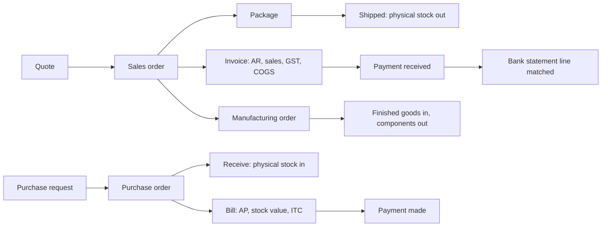

# 01 · Product overview

Saral ERP is a web application that runs the day-to-day operations and books of an Indian small or mid-sized business:
selling and buying, stock, production, payroll, banking and GST compliance, all posting to one double-entry ledger.

It is a single server process (Node.js + SQLite) that serves both the REST API and the browser app. One installation
holds one organisation.

## Who uses it

| Role (default) | Typical work |
|---|---|
| Admin | Everything, including users, roles, backups |
| Accountant | Journals, banking, assets, GST returns, sales and purchase documents |
| Sales Executive | Customers, quotes, sales orders, invoices |
| Purchase Officer | Vendors, purchase requests, RFQs, purchase orders, bills |
| Warehouse Manager | Items, packages, receives, transfers, adjustments, stock counts |
| Production Manager | BOMs, manufacturing orders, job cards, quality inspections |
| HR Manager | Employees, salary structures, pay runs |

Roles are editable; see [14 Platform services](14-platform-services.md#roles-and-permissions).

## Modules

| Area | What it does | Detail |
|---|---|---|
| Home | Receivables/payables ageing, income vs expense, cash flow, top expenses, bank balances, sales activity, stock alerts, pending approvals, rule-based insights | `server/src/dashboard.ts` |
| Items | Goods and services, HSN/SAC, GST rate or exempt/nil/non-GST, accounts per item, opening stock per warehouse, reorder level, batch or serial tracking, price lists, CSV import | [07](07-inventory-valuation.md) |
| Sales | Customers, quotes, sales orders, packages and shipments, delivery challans, invoices, recurring invoices, retainer invoices, payments received, sales returns, credit notes, refunds | [05](05-documents-engine.md), [08](08-sales-purchases-payments.md) |
| Purchases | Vendors, purchase requests, RFQs and bids, purchase orders, receives (GRN) with quality inspection, bills with ITC/RCM/TDS/landed cost, payments made, vendor credits, expenses | [05](05-documents-engine.md), [08](08-sales-purchases-payments.md) |
| Inventory | Physical vs accounting stock, committed and incoming quantities, warehouses, transfers, adjustments, stock counts, FIFO or weighted-average costing with automatic re-costing | [07](07-inventory-valuation.md) |
| Manufacturing | Work centres, BOMs with wastage and routing, manufacturing orders, job cards with time logs, shop floor, capacity calendar, quality rules and inspections, production costing, MRP | [11](11-manufacturing.md) |
| Accountant | Chart of accounts, manual journals, account ledgers, budgets, transaction locking | [06](06-accounting-ledger.md), [13](13-fixed-assets-budgets.md) |
| Banking | Bank/cash/card accounts, statement import, match and categorise, bank transactions, reconciliation | [10](10-banking.md) |
| Fixed assets | Asset register, straight-line and written-down-value depreciation, disposal | [13](13-fixed-assets-budgets.md) |
| People & payroll | Employees, CTC salary structures, EPF/ESI/PT/TDS, pay runs, payslips, salary payment | [12](12-payroll.md) |
| Filing & compliance | GSTR-1 (with portal JSON), GSTR-3B with set-off, GSTR-2B reconciliation, e-invoice and e-way bill files and records | [09](09-gst-and-e-invoicing.md) |
| Reports | 44 reports with CSV export and print | [15](15-reports.md) |
| Platform | First-run setup, users, roles, approvals, workflow rules, webhooks, custom fields and modules, numbering, audit trail, comments, notifications, email, search, backups | [14](14-platform-services.md) |

## Design principles

1. **One ledger is the source of truth.** Every financial transaction posts a balanced journal. Reports are computed
   from journal lines, so the trial balance and balance sheet always balance (tests enforce it).
2. **Documents drive everything.** Quotes, orders, invoices, bills, receives, transfers and so on are all rows in one
   `documents` table, handled by one engine with per-type rules (`server/src/documents/`).
3. **Derived data is rebuilt, not patched.** When a document changes, its stock moves and journal are deleted and
   rebuilt from the document. When a back-dated transaction changes stock costs, every affected journal is re-posted.
4. **Two stock views.** Receives and shipments move *physical* stock; bills and invoices move *accounting* stock. A
   bill or invoice without an order moves both. This matches how goods and paperwork arrive at different times.
5. **Rules live on the server.** The browser never computes tax or totals that are trusted; the server recomputes and
   validates everything.
6. **Statutory values are data.** GST rates, TDS sections, PF/ESI rates, professional-tax slabs and income-tax slabs are
   editable settings with sourced defaults ([22](22-statutory-reference.md)).

## What a typical day looks like in the data

