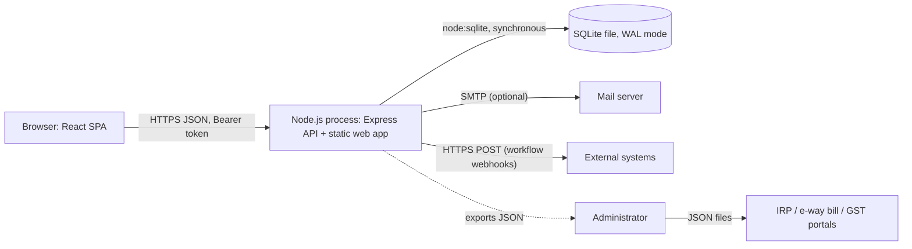
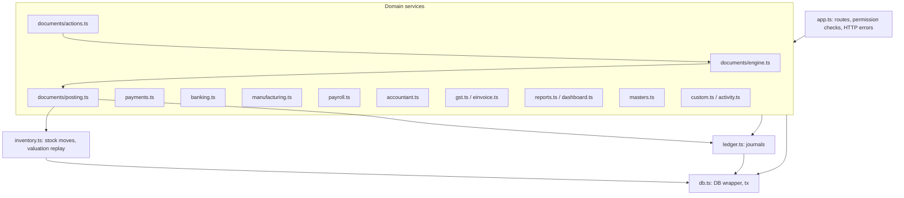

# 03 · Architecture

## Context

- **One process, one database file.** Simple to deploy and back up; scales to the transaction volumes of a small or
  mid-sized business on one server.
- **Synchronous data access.** `node:sqlite` is synchronous, so each request runs its business logic and its SQL in one
  uninterrupted call stack. A request that writes runs inside one transaction (`db().tx()`), which also serialises
  writers.
- **Government portals are reached by people, not the server.** The server prepares e-invoice, e-way bill and GSTR-1
  JSON files and records what the portals return ([09](09-gst-and-e-invoicing.md)).

## Server layers

| File | Responsibility |
|---|---|
| `index.ts` | Node.js entry: open the SQLite file, start-up work, hourly timer, HTTP server, graceful shutdown |
| `worker.ts` | Cloudflare entry: Worker routing `/api` to the `ErpDatabase` Durable Object, which runs the same app and an hourly alarm ([25](25-cloudflare.md)) |
| `startup.ts` | Start-up work shared by both entries (unattended setup, setup code log, interrupted emails) and `hourlyJobs()` |
| `runtime.ts` | `onWorkers` flag and runtime name |
| `app.ts` | Express app: security headers, body parsing, public routes (`/api/health`, `/api/auth/login`, `/api/setup`), authenticated router, static web app, error handler |
| `db.ts` | `DB` class (`all/get/value/run/insert/update/tx/backup`) over a `SqlDriver`, `useDatabase()`, `dumpSql()`, `HttpError`, `fail()` |
| `db-node.ts` / `db-durable.ts` | Drivers: `node:sqlite` file (prepared-statement cache, `BEGIN IMMEDIATE`/savepoints, `PRAGMA user_version`, `VACUUM INTO`) and Durable Object SQLite (`transactionSync`, `_schema_meta`, SQL dump) |
| `schema.ts` | The full schema as `CREATE … IF NOT EXISTS` |
| `migrations.ts` | Versioned, idempotent upgrades of existing databases (version stored by the driver) |
| `seed.ts` | `bootstrap()` base configuration, first-run setup, setup code, inventory re-post hook registration |
| `settings.ts` | Organisation profile, payroll settings, lock dates, numbering series |
| `auth.ts` | Password hashing, sessions, sign-in throttling, roles and permission checks |
| `ledger.ts` | Default chart of accounts, posting and replacing journals, bank-match consistency |
| `tax.ts` | Supply kind, line GST computation, TDS, GST set-off |
| `inventory.ts` | Stock moves, stock validation, FIFO/average replay, stock queries |
| `documents/types.ts` | Definitions of the 18 document types |
| `documents/engine.ts` | Prepare/validate/save documents, statuses, approvals, conversions, list/read/delete/void |
| `documents/posting.ts` | Stock moves and journal for each document type |
| `documents/actions.ts` | Registry of document actions (submit, approve, ship, receive, record IRN, …) |
| `masters.ts` | Contacts, items, accounts, warehouses, taxes, price lists |
| `payments.ts` | Payments, allocations, credit application, refunds |
| `banking.ts` | Bank transactions, statement import, matching, categorising, reconciliation |
| `accountant.ts` | Manual journals, account ledger, fixed assets, depreciation, budgets |
| `manufacturing.ts` | Work centres, BOMs, MOs, job cards, quality, MRP |
| `payroll.ts` | Employees, salary structure, payslip computation, pay runs |
| `gst.ts` | GSTR-1, GSTR-3B, GSTR-2B reconciliation |
| `einvoice.ts` | e-invoice and e-way bill JSON, recording IRN/EWB |
| `reports.ts` | 44 reports and CSV |
| `dashboard.ts` | Home dashboard, insights, global search, recurring invoices |
| `custom.ts` | Custom modules, custom records, custom fields, workflow rule validation |
| `activity.ts` | Audit log, notifications, email outbox and SMTP, workflow engine, webhooks |
| `util.ts` | Rounding, dates, states, GSTIN check digit, format checks, amount in words |

## Request lifecycle

1. `securityHeaders` sets CSP and other headers.
2. Body parsing (`express.json` up to 10 MB; `text/csv` and `text/plain` as text).
3. For `/api/*` other than health/login/setup: `authMiddleware` reads `Authorization: Bearer <token>`, loads the session
   and user. A user who must change their password can only reach `/auth/password`, `/auth/me`, `/auth/logout`, `/meta`.
4. Route-level permission check (`perm(module, action)`, `adminOnly`, `itemLookup`, or `assertCan` inside the handler).
5. Handler calls a domain service. Services validate input and call `fail(message, status)` on any problem.
6. The `h()` wrapper sends the return value as JSON (`{ ok: true }` when nothing is returned).
7. Errors: `HttpError` → its status and message (plus `details`); body-parser errors → 400/413; anything else → 500
   with a generic message and a reference id that is also written to the server log.

## Transactions and consistency

- `db().tx(fn)` runs `fn` in a transaction (`BEGIN IMMEDIATE` and savepoints on Node.js, `transactionSync()` on Cloudflare);
  nested calls roll back only their own work, any exception rolls back. All multi-step writes
  (create a document → write lines → post stock → post journal → refresh parents → run workflows) happen inside one.
- Derived data is always rebuilt from its source:
  - `syncPosting(docId)` deletes and recreates the document's stock moves, revalues the affected items and replaces its
    journal.
  - `replaceJournal(sourceType, sourceId, spec)` deletes every journal of a source and posts the new one, carrying bank
    reconciliation marks and releasing bank-statement matches that no longer fit.
  - `revalueItems(itemIds)` replays the item's accounting moves in date order; any source whose stock value changed has
    its journal re-posted through a hook registered in `seed.ts → registerHooks()`.
- Invariants checked by tests: debits = credits for every journal, trial balance balances, Inventory Asset ledger equals
  the stock valuation.

## Background work

`hourlyJobs()` (`startup.ts`) runs hourly — from a timer on Node.js (plus once at start) and from the Durable Object
alarm on Cloudflare:

- `runRecurring()` — generates invoices from due recurring profiles (each profile in its own transaction).
- `purgeExpiredSessions()` — deletes expired sessions.

Webhook calls and SMTP sends run asynchronously after the request transaction finishes; their outcome is written to
`workflow_log` / `email_outbox`.

## Key decisions and trade-offs

| Decision | Why | Trade-off |
|---|---|---|
| SQLite via `node:sqlite` | Zero-ops, single file backup, fast for this workload | One writer at a time; vertical scaling only. Module is marked experimental in Node 22 (prints a warning) |
| Same app on Cloudflare in one Durable Object | Synchronous SQLite API matches the code; no servers to run; durable storage with point-in-time recovery | One object = one writer, like SQLite; needs the Workers Paid plan for CPU time |
| Generic document engine | 18 document types share validation, numbering, approvals, posting, conversions and UI | Type-specific rules are `if (type === …)` branches in a few places; see [21](21-extending.md) before adding types |
| Rebuild derived data | Correctness by construction; back-dated entries re-cost later ones | Re-posting large histories costs CPU; acceptable at SMB scale |
| Store document-specific extras in `documents.data` JSON | Flexible (e-invoice, shipment, challan type…) | Not indexed; query with `json_extract` |
| Permissions per module × action | Simple to reason about | No record-level (e.g. "own documents only") rules |
| Prepare government JSON, record results | Works without GSP credentials; no fake IRNs | Users upload files manually; see roadmap for direct API integration |
