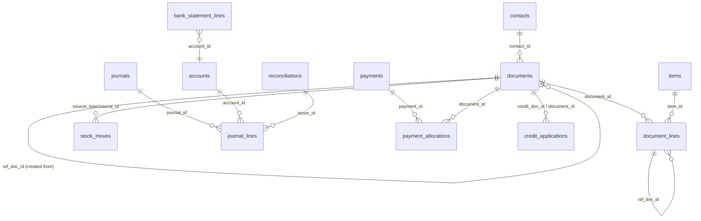

# 04 · Data model

The schema lives in `server/src/schema.ts`; upgrades of existing databases live in `server/src/migrations.ts`.
All tables use `INTEGER PRIMARY KEY` ids (SQLite rowids) unless noted. JSON columns are `TEXT` holding JSON; parse them
with `json()` from `db.ts`. Booleans are `INTEGER` 0/1. Dates are `TEXT` `YYYY-MM-DD`; timestamps are ISO strings.

Foreign keys are enforced (`PRAGMA foreign_keys = ON`). Child rows that belong to a parent use `ON DELETE CASCADE`.

## Entity relationships (core)

Journals and stock moves point back to whatever produced them with `source_type` + `source_id` (not a foreign key),
because many different tables produce them.

## Configuration and security

| Table | Purpose | Key columns |
|---|---|---|
| `kv` | Settings stored as JSON by key | `key` (`org`, `payroll`, `lock_dates`, `approvals`), `value` |
| `roles` | Permission sets | `name` unique, `is_admin`, `permissions` JSON `{ module: { view, create, edit, delete, approve } }` |
| `users` | People who sign in | `email` unique (case-insensitive), `password_hash` (`salt:scrypt-hex`), `role_id`, `is_active`, `must_change_password`, `last_login_at` |
| `sessions` | Bearer tokens | `token` (64 hex chars) PK, `user_id`, `expires_at` (7 days) |
| `sequences` | Numbering series | `type` PK (document type, `payment_received`, `journal`, `custom:<key>` …), `prefix`, `next_no`, `padding` |
| `currencies` | Currencies and manual exchange rates | `code` PK, `rate` (INR per unit), `is_base` (INR) |
| `taxes` | GST rates | `rate`, `is_active` (12% and 28% kept inactive for old documents) |
| `tds_sections` | TDS sections for vendor bills | `section` (e.g. 194C), `rate` |
| `warehouses` | Locations | `address`, `city`, `pincode` (e-way dispatch address), `state_code`, `gstin`, `is_primary` |

## Masters

| Table | Purpose | Notes |
|---|---|---|
| `accounts` | Chart of accounts | `type` (see [06](06-accounting-ledger.md#account-types)), `system_key` for accounts the code posts to, `parent_id`, bank details |
| `contacts` | Customers and vendors | `kind` customer/vendor; `gst_treatment`; `gstin`; `place_of_supply`; billing/shipping address with `*_city`, `*_pincode`, `*_state`, `billing_country`; `payment_terms`; `currency_code`; `credit_limit`; `price_list_id`; `opening_balance`; `tds_section_id`; `custom` JSON |
| `items` | Goods and services | `type`, `unit`, `hsn_code`, `tax_preference` (taxable/exempt/nil/non_gst), `tax_id`, rates, per-item accounts, `track_inventory`, `tracking` (none/batch/serial), `reorder_level`, `opening_stock` JSON `[{warehouse_id, qty, rate, tracking}]` |
| `price_lists`, `price_list_items` | Sales or purchase price lists | `mode` percentage (mark-up/down) or per_item |

## Transactions

### `documents` — every sales, purchase and inventory document

| Column group | Columns |
|---|---|
| Identity | `type` (one of 18, see [05](05-documents-engine.md)), `number` (unique per type), `date`, `due_date`, `status` |
| Progress | `fulfil_status`, `billing_status` (orders), `approval_level` |
| Parties and places | `contact_id`, `warehouse_id`, `to_warehouse_id` (transfers), `place_of_supply`, `gst_treatment`, `gstin` (snapshot) |
| Currency | `currency_code`, `exchange_rate` (INR per unit) — line amounts are in document currency |
| Tax flags | `reverse_charge`, `tax_inclusive` |
| Totals | `subtotal`, `discount_total`, `taxable_total`, `cgst_total`, `sgst_total`, `igst_total`, `cess_total`, `tax_total`, `tds_amount`, `adjustment`, `total`, `balance` |
| Links | `ref_doc_id` (document it was created from), `reference` (free text; for bills the vendor's bill number) |
| Text | `notes`, `terms`, `salesperson`, `payment_terms` |
| Extensible | `data` JSON (e-invoice, e-way bill, shipment, challan type, TDS section, landed-cost method, void reason, …), `custom` JSON (custom fields) |

### `document_lines`

`item_id` or `account_id` (or a description-only line), `qty`, `qty2` (second quantity: counted qty for stock counts,
new value for value adjustments, accepted qty for receives), `rate`, `discount_pct`, `tax_id`, `tax_rate`, `tax_exempt`,
computed `taxable`, `cgst`, `sgst`, `igst`, `landed_cost`, `ref_line_id` (line it came from), `warehouse_id` (line-level
override), `itc_eligible`, `tracking` JSON (`[{batch_no, qty, expiry_date}]` or `[{serial_no}]`), `data` JSON
(`landed_cost`, `return_to_stock`, value-adjustment figures).

### Other transaction tables

| Table | Purpose |
|---|---|
| `rfq_bids` | One vendor's price for one RFQ line; `awarded`, `surrogate` (entered by staff) |
| `payments` | Payments received/made: `amount`, `bank_charges`, `tds_amount`, `mode`, `account_id`, currency |
| `payment_allocations` | Part of a payment settled against an invoice/bill |
| `credit_applications` | Credit note / vendor credit / retainer / excess payment applied to an invoice/bill |
| `refunds` | Money returned from a credit or an unused payment |
| `recurring_profiles` | Invoice templates generated on a schedule |

## Ledger and stock

| Table | Purpose |
|---|---|
| `journals` | Header: `date`, `source_type`, `source_id`, `number` (manual journals), `status` posted/draft, `is_manual` |
| `journal_lines` | `account_id`, `debit`, `credit`, `contact_id`, `item_id`, `description`, `recon_id` (bank reconciliation) |
| `stock_moves` | `item_id`, `warehouse_id`, `date`, `qty` (+in/−out), `physical`, `accounting`, `kind`, `unit_cost`, `value` (INR), `value_delta` (value adjustments), `source_type/source_id/source_line_id`, `ref_source_line_id` (returns), `batch_no`, `serial_no`, `expiry_date` |

`stock_moves.kind` values: `opening`, `purchase`, `sale`, `return_in`, `return_out`, `receive`, `ship`, `challan`,
`transfer`, `adjust`, `value_adjust`, `mo_consume`, `mo_produce`.

## Banking

| Table | Purpose |
|---|---|
| `bank_statement_lines` | Imported statement rows; `status` uncategorized / matched / categorized / excluded; `matched_source_type/id` |
| `bank_transactions` | Transfers, deposits, expenses, owner contributions etc. posted from the banking module |
| `reconciliations` | Completed reconciliation per account and end date with closing balance |

## Manufacturing

`work_centers`, `boms`, `bom_components` (`qty`, `wastage_pct`), `bom_operations` (`seq`, `work_center_id`, `minutes`),
`manufacturing_orders` (status draft/confirmed/in_progress/completed/cancelled; costs), `mo_components`
(`required_qty`, `consumed_qty`), `job_cards`, `job_card_logs`, `quality_rules` (`parameters` JSON), `quality_inspections`.

## Payroll

`departments`, `designations`, `employees` (CTC, statutory flags, `ytd_fy/ytd_gross/ytd_tds` opening year-to-date),
`salary_components` (`calc`: pct_ctc / pct_basic / fixed / balance), `pt_slabs`, `pay_runs` (one per month),
`payslips` (earnings/deductions/employer JSON arrays, `extra` JSON with TDS etc.).

## Assets and budgets

`asset_types`, `assets`, `asset_depreciation` (one row per asset per month posted), `budgets`, `budget_lines`
(`amounts` JSON: 12 monthly amounts).

## Platform

| Table | Purpose |
|---|---|
| `audit_log` | Who did what: `entity`, `entity_id`, `action`, `summary`, `user_id`, `data` |
| `comments` | Comments on any entity |
| `notifications` | In-app notifications per user |
| `email_outbox` | Every email: `status` queued / sending / sent / failed, `error`, `sent_at` |
| `approval_history` | Submissions, approvals and rejections per level |
| `workflow_rules`, `workflow_log` | Automation rules and their results |
| `custom_fields` | Extra fields for built-in modules (`module`, `key`, `type`, `options`) |
| `custom_modules`, `custom_records` | User-defined record types and their records |

## Indexes

Besides the indexes in `schema.ts`, migrations add: `idx_documents_reference`, `idx_sessions_user`,
`idx_bsl_match` (statement lines by matched source), `idx_journals_number`, `idx_bank_txn_number`, `idx_outbox_status`.

## Migrations

The applied version is kept by the database driver: `PRAGMA user_version` on Node.js, the `_schema_meta` row
`schema_version` on Cloudflare (where the pragma is not allowed). On start, `bootstrap()` calls `migrate()`, which runs every migration
with a higher version, each in its own transaction. Migrations must be idempotent because a brand-new database already
has the latest schema from `schema.ts` (and starts at version 0, so all migrations run and find nothing to change).

| Version | Change |
|---|---|
| 1 | `users.last_login_at`; structured contact addresses; `email_outbox.error/sent_at`; `employees.ytd_*`; `warehouses.city/pincode`; reference and session indexes |
| 2 | `users.must_change_password`; flags accounts still using a former built-in password; matching/numbering/outbox indexes |

A database newer than the build (higher stored version) is refused at start-up. How to add a migration:
[21 Extending](21-extending.md#add-a-database-change).
