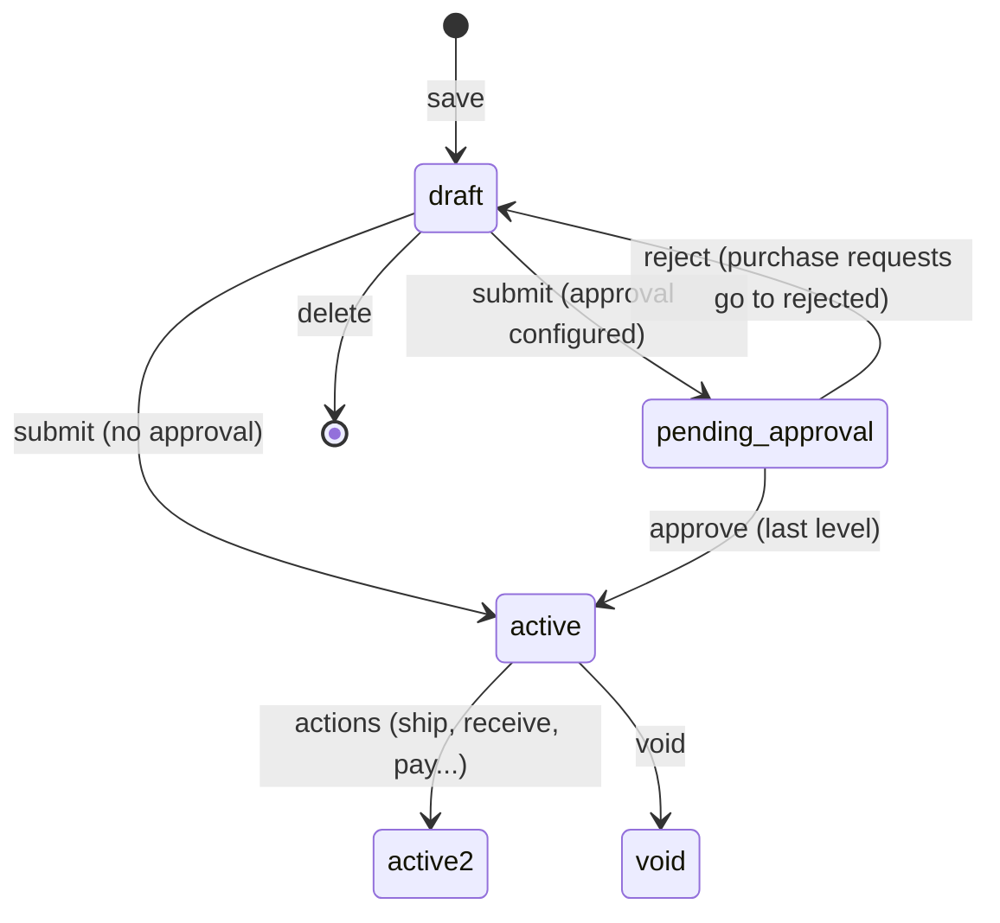

# 05 · Document engine

All sales, purchase and inventory paperwork is one kind of record: a **document** with **lines**. The engine in
`server/src/documents/` gives every type the same behaviour (numbering, validation, GST, approvals, posting, conversion,
audit, workflows) and lets each type differ only where it must.

| File | Role |
|---|---|
| `types.ts` | `DOC_TYPES`: one `DocTypeDef` per type |
| `engine.ts` | `prepare`, `validateRefs`, `createDocument`, `updateDocument`, `deleteDocument`, `voidDocument`, statuses, approvals, conversions, list/read |
| `posting.ts` | `buildMoves` (stock) and `buildJournal` (ledger) per type; `syncPosting` |
| `actions.ts` | `ACTIONS` registry: everything you can do to a saved document besides edit/delete |

## The 18 document types

| Type | Module (permission) | Party | Priced (GST) | Active status | Posted in statuses | Created from |
|---|---|---|---|---|---|---|
| `quote` | sales | customer | yes | sent | — | — |
| `sales_order` | sales | customer | yes | confirmed | — | quote |
| `package` | inventory | customer | no | packed | shipped, delivered | sales_order |
| `invoice` | sales | customer | yes | open | open, partially_paid, paid | quote, sales_order, delivery_challan |
| `credit_note` | sales | customer | yes | open | open, closed | invoice, sales_return |
| `sales_return` | sales | customer | no | approved | received, credited | sales_order, invoice |
| `delivery_challan` | sales | customer | yes | open | open, delivered, invoiced | sales_order |
| `retainer_invoice` | sales | customer | no (advance) | open | — (payments post) | quote |
| `purchase_request` | purchases | — | no | approved | — | — |
| `rfq` | purchases | — | no | open | — | purchase_request |
| `purchase_order` | purchases | vendor | yes | issued | — | purchase_request, rfq, sales_order |
| `purchase_receive` | inventory | vendor | no | received | received | purchase_order |
| `bill` | purchases | vendor | yes | open | open, partially_paid, paid | purchase_order, purchase_receive |
| `vendor_credit` | purchases | vendor | yes | open | open, closed | bill |
| `expense` | purchases | vendor (optional) | yes | recorded | recorded | — |
| `transfer_order` | inventory | — | no | in_transit | in_transit, transferred | — |
| `inventory_adjustment` | inventory | — | no | adjusted | adjusted | stock_count |
| `stock_count` | inventory | — | no | in_progress | — | — |

"Posted" means the document affects stock and/or the ledger in that status. The full status list of each type is in
`DOC_TYPES[type].statuses`. Types that can be routed for approval have `approvable: true`.

## Lifecycle

- **Draft-less types**: packages, sales returns and purchase receives are created directly in their active status.
  A receive starts as `pending_inspection` when any line's item has an active quality rule for receives.
- **Edit**: allowed unless the document is void, closed, invoiced, ordered, transferred, completed, credited, cancelled
  or adjusted (receives are an exception), has an active IRN, is in a locked period, or is part of a completed bank
  reconciliation.
- **Delete**: only when nothing was created from it, no payments/credits/refunds are applied, there is no active IRN, no
  live manufacturing order is linked, and it is not reconciled. Deleting removes its stock moves and journals.
- **Void**: keeps the number (for GST document series) but removes stock moves and journals. Blocked if payments or
  credits are applied or child documents exist. A sales order with packages or invoices should be **closed** instead.

## Saving a document (`createDocument` / `updateDocument`)

All in one transaction:

1. **`prepare(type, input)`** normalises input and computes everything:
   - Party: must exist and be the right kind; defaults (payment terms, place of supply, currency, price list) come from
     the contact.
   - Warehouse defaults to the primary warehouse for types that need one.
   - Due date = date + payment terms when not given.
   - Place of supply: from input, else contact, else the organisation's state; overseas customers use `96`.
   - Exchange rate from the currency table unless given.
   - **Supply kind** (`tax.ts → supplyKind`): intra-state, inter-state, zero-rated or none
     ([09](09-gst-and-e-invoicing.md#supply-kind)). The "our state" is the warehouse's state if set, else the
     organisation's.
   - Each line: item defaults (description, HSN, unit, rate by side, tax), quantity/rate/discount checks, tax computed
     with `computeTaxLine` (tax-inclusive pricing supported).
   - **Landed cost** (bills): account lines flagged `data.landed_cost` are spread over stock lines by value or quantity
     (`data.landed_method = 'quantity'`) and capitalised into those items' cost.
   - **Value adjustments**: `qty2` is the new stock value; the engine records the current value and the delta.
   - **TDS** (bills): `data.tds_section_id` → TDS = taxable total × section rate, deducted from the total.
   - Totals: `total = taxable + tax (not for reverse charge) + adjustment − TDS`.
2. **Lock check**: the document date (old and new) must be after the module's lock date.
3. **`validateRefs`**: when created from another document, the parent must be active and the right type; line
   references must belong to the parent; items must match; quantities cannot exceed what is left
   (see [Quantity consumption](#quantity-consumption)).
4. **Duplicate vendor bill check**: a vendor's bill number (`reference`) can only be used once per vendor (409).
5. **Status**: draft unless submitted; submitted → `pending_approval` if approvals are configured, else the active status.
6. **Number**: `nextNumber(type)`; skips numbers already used if the counter was moved back.
7. **Lines** written (on update: kept by id, removed lines must not be referenced by other documents).
8. **`afterSave`**: `syncPosting` (stock + journal), `refreshBalance` (paid/credited amounts, payment status),
   `refreshParent` (parent's progress and status), audit entry.
9. Approval request notifications; **workflow rules** (`on_create` / `on_update`).

## Quantity consumption

`CONSUMES` in `engine.ts` says which child types use up a parent line's quantity:

| Child | Parent | Consumes from parent line |
|---|---|---|
| package | sales_order | packages |
| delivery_challan | sales_order | challans + packages |
| invoice | sales_order / delivery_challan | invoices |
| credit_note | invoice / sales_return | credit notes |
| sales_return | sales_order / invoice | returns (from an order: limited to what was shipped) |
| purchase_receive | purchase_order | receives (accepted quantity only) |
| bill | purchase_order | bills |
| vendor_credit | bill | vendor credits (price-correction lines excluded) |

`consumedQty(lineId, childTypes)` sums child line quantities, ignoring void and returned children. Receives count
`qty2` (accepted) when set, so rejected goods can be received again. Price-correction vendor-credit lines
(`data.return_to_stock = false`) do not consume the bill quantity, but all price corrections of a bill line together
cannot exceed its quantity.

## Parent progress (`refreshParent`)

- **Sales order**: `fulfil_status` pending / partially_shipped / shipped from goods lines on shipped or delivered
  packages and on challans; `billing_status` from invoiced quantity. Fully shipped and invoiced → `closed`; reopens
  automatically if a child is removed (unless closed by hand).
- **Purchase order**: `fulfil_status` from received quantity; `billing_status` from billed quantity; same auto close.
- **Others** (status from posted children): quote → `invoiced` / `accepted`; purchase request → `ordered`; RFQ →
  `ordered`; delivery challan → `invoiced`; sales return → `credited` only when the goods are received **and** an issued
  credit note exists; stock count → `completed` when its adjustment is posted. Draft, rejected and cancelled children
  never count.

## Conversions (`convertDraft` / `createFrom`)

`GET /api/docs/:type/:id/convert/:to` returns an unsaved draft of the target type with the **remaining** quantities;
`POST` creates it. Special cases:

- Bill from a receive → references the purchase-order lines behind the receive, quantity = accepted quantity.
- Purchase order from an RFQ → only awarded lines, at the awarded vendor's rate, one PO per vendor (`create_pos`).
- Purchase order from a sales order → item purchase rates, vendor chosen by the user.
- Priced documents created from unpriced ones (credit note from a sales return) take rate, discount and tax from the
  priced ancestor line (`pricedAncestor`).
- Packages, challans, receives and returns keep only goods lines.

## Actions (`actions.ts`)

`POST /api/docs/:type/:id/actions/:action` with a JSON body. Each action declares the document types it applies to, when
it is available (`when(doc)`), and the permission it needs. `availableActions(doc)` drives the buttons in the UI.

| Action | Types | Available when | Permission | Body |
|---|---|---|---|---|
| `submit` | all with drafts | draft, rejected | edit | — |
| `approve` / `reject` | approvable types | pending_approval | approve (+ level rule) | `comment` |
| `void` | sales_order, invoice, credit_note, bill, vendor_credit, expense, retainer_invoice, sales_return | not draft/void | delete | `reason` |
| `email` | quote, sales_order, invoice, credit_note, purchase_order, retainer_invoice, delivery_challan, rfq | not void | edit | `to` (optional) |
| `comment` | all | always | view | `body` |
| `mark_accepted` / `mark_declined` | quote | sent / declined / accepted | edit | — |
| `close` | sales_order, purchase_order, purchase_request | confirmed / issued / approved | edit | — |
| `reopen` | sales_order, purchase_order | closed | edit | — |
| `cancel` | purchase_order, rfq, stock_count | no live children | edit | — |
| `ship` / `deliver` / `unship` | package | packed / shipped | edit | `date`, `carrier`, `tracking_no`, `charges` |
| `receive_return` | sales_return | approved | edit | `date`, `warehouse_id` |
| `mark_delivered` / `mark_returned` | delivery_challan | open / delivered | edit | — |
| `mark_transferred` | transfer_order | in_transit | edit | `date` |
| `einvoice_record` | invoice, credit_note | issued, no IRN | edit | `irn`, `ack_no`, `ack_date`, `signed_qr` |
| `einvoice_cancel` | invoice, credit_note | IRN recorded | edit | `reason_code` 1–4, `remarks` |
| `eway_record` | invoice, delivery_challan, credit_note | issued, no EWB | edit | `ewb_no`, `ewb_date`, transport fields |
| `eway_update_vehicle` | same | EWB recorded | edit | `vehicle_no`, `reason_code`, `remarks` |
| `eway_cancel` | same | EWB recorded | edit | `reason_code` 1–4, `remarks` |
| `apply_credits` | credit_note, vendor_credit, retainer_invoice | open (retainer: paid/open) | edit | `allocations[]`, `date` |
| `publish` / `record_bid` / `close_bidding` / `award` / `create_pos` | rfq | draft / open / … | edit/approve/create | see [08](08-sales-purchases-payments.md#purchase-flow) |
| `start_count` / `complete_count` | stock_count | draft / in_progress | edit | `counts[]`, `tracking` |

Every action runs in a transaction and returns `{ result, document }`.

## Approvals

Configured per approvable type in Settings → Approvals (`kv.approvals`):

- `none` — submit goes straight to the active status.
- `simple` — any user whose role has `approve` on the type's module (or an admin) approves.
- `multi` — an ordered list of role ids; each level must be approved by a user of that role (admins can approve any
  level and finalise). Each step is written to `approval_history`; approvers and the creator are notified.

## Listing and reading

`GET /api/docs/:type` supports `status` (including `overdue` and `unpaid` for invoices/bills), `contact_id`, `from`,
`to`, `search` (number, reference, contact), `ref_doc_id`, `sort` (number/total/contact/due_date), `dir`, `limit`
(≤ 1000, default 200) and `offset`. It returns `{ rows, total }`.

`GET /api/docs/:type/:id` returns the document with lines (plus consumed quantities per child type), contact, related
documents, payments, credits, refunds, RFQ bids, journal lines, stock moves, approval trail, audit history, comments,
`amount_in_words`, `can_approve`, the organisation profile and the available `actions`.
