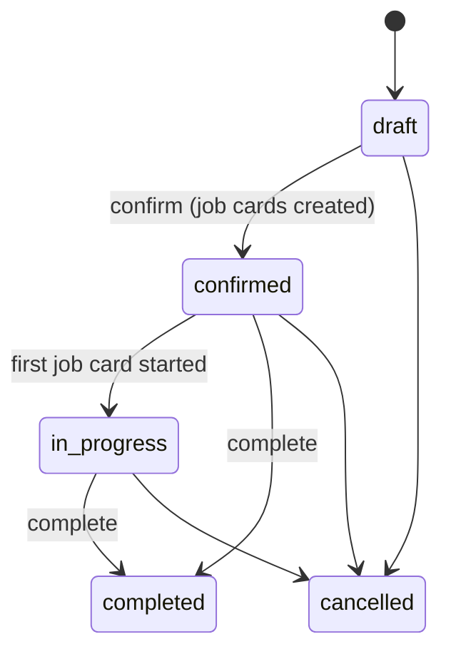

# 11 · Manufacturing

Code: `server/src/manufacturing.ts`. UI: `web/src/pages/Manufacturing.tsx`.

## Masters

- **Work centre**: code (unique), cost per hour, capacity hours per day. The list shows pending orders, running job
  cards and remaining load (planned − actual minutes).
- **Bill of materials (BOM)**: finished item (must be a stock item), output quantity, overhead cost per BOM quantity,
  default flag (one default per item), active/inactive.
  - Components: item, quantity per BOM quantity, wastage % (0–99). An item cannot be its own component, and a
    component whose BOM already uses the finished item is refused (direct cycle).
  - Operations (routing): sequence, name, work centre, minutes per BOM quantity.
  - A BOM used by manufacturing orders cannot be deleted; mark it inactive.

## Manufacturing order (MO) lifecycle



1. **Create** (`saveMo`): active BOM, quantity, date, warehouse (default primary), optional sales order and planned
   start. Required component quantity = BOM qty × (MO qty ÷ BOM qty) × (1 + wastage %). Overhead = BOM overhead ×
   (MO qty ÷ BOM qty). Only drafts can be edited.
2. **From a sales order** (`POST /api/manufacturing/orders/from-sales-order/:id`): one MO per order line whose item has an
   active BOM, for the quantity not already planned.
3. **Confirm** (release): creates one job card per BOM operation with planned minutes scaled to the quantity, scheduled
   back-to-back from the planned start (09:00); returns material shortages
   (`materialAvailability`: on hand in the warehouse − reserved by other released MOs).
4. **Job cards** (`POST /api/manufacturing/job-cards/:id/:action`): `start` (also resumes a paused card; the previous
   operation must be complete unless `force`; optional `employee_id`), `pause`, `complete` (optional `minutes` as a
   manual time entry, `notes`), `log_time` (`minutes`, `employee_id`, `notes`), `assign` (`employee_id`). Running time is
   logged in `job_card_logs` and summed into `actual_minutes`; starting or completing the first card moves the MO to
   `in_progress`. Cancelling an MO cancels its open job cards.
5. **Quality**: if the finished item has an active quality rule for manufacturing, an inspection must be recorded before
   completion; its accepted/rejected quantities become produced/rejected.
6. **Complete** (`completeMo`): date on/after the MO date and not locked; open job cards must be completed (or pass
   `auto_complete_job_cards`, which books planned time); consumption defaults to required × (produced + rejected) ÷ MO
   qty, overridable per component with tracking. Batch components are auto-allocated earliest-expiry-first when not
   chosen; serial components must be chosen. Output tracking (batches/serials) for the finished item is accepted.
7. **Cancel**: not for completed orders (reverse with an inventory adjustment). **Delete**: draft or cancelled only.

## Costing

On completion the MO posts stock moves `mo_consume` (components out) and `mo_produce` (finished goods in).

```
labour = Σ over job cards of (actual minutes, or planned if none) ÷ 60 × work-centre cost per hour
finished goods value = component value consumed (FIFO/average) + labour + overhead
unit cost = finished goods value ÷ total produced quantity
```

Journal (`postMoJournal`): Inventory (finished item) debit; Inventory (components) credit; the difference — labour and
overhead absorbed — is credited to "Manufacturing Conversion Cost Absorbed" (a COGS-group account), so actual labour and
overhead booked elsewhere (salaries, rent) are offset when goods are produced. If component costs change later
(back-dated purchase), the finished goods are re-valued and the journal re-posted.

## Quality

- **Quality rules** per item: applies to manufacturing, purchase receives or both; parameters are pass/fail or numeric
  with min/max.
- **Inspections** for a released MO (`source_type = mo`) or a receive line (`purchase_receive`). Created automatically
  for receives of items with a receive rule. `record` takes accepted and rejected quantities (must add up to the
  inspected quantity) and parameter results (numeric results are checked against the range). Status passed / failed /
  partial.
- For receives, the accepted quantity becomes the line's `qty2`; when no inspections are pending the receive becomes
  `received` and stock enters. An inspection can only be recorded while its receive is `pending_inspection`; deleting
  the receive deletes its inspections.

## Planning views

- **Shop floor** (`GET /api/manufacturing/shop-floor`): each active work centre with its pending, running and paused job
  cards of released orders.
- **Calendar** (`GET /api/manufacturing/calendar?from&to`): job cards by planned start with work-centre capacity.
- **MRP** (`GET /api/manufacturing/mrp`): per stock item, demand = committed sales-order quantity + open MO component
  needs + reorder level; supply = on hand + open PO quantity + open MO output; shortage = demand − supply; suggested
  action `make` (item has a BOM) or `buy` with the preferred vendor.
