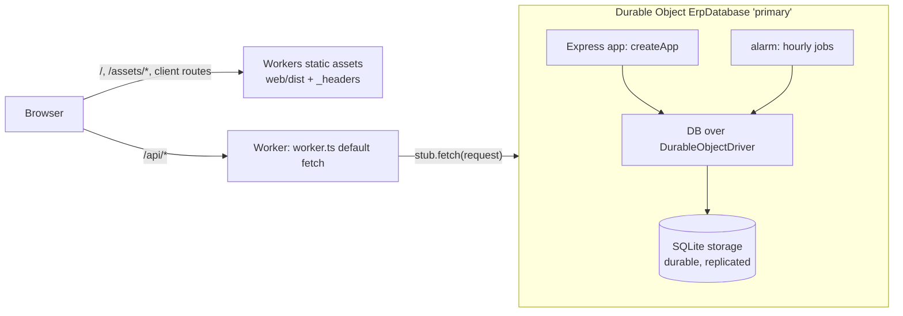

# 25 · Running on Cloudflare

Saral ERP runs in two ways from the same code:

| | Node.js server | Cloudflare |
|---|---|---|
| Entry point | `server/src/index.ts` | `server/src/worker.ts` |
| Database | SQLite file through `node:sqlite` (`db-node.ts`) | SQLite storage of one Durable Object (`db-durable.ts`) |
| Web app | Served by Express from `web/dist` | Workers static assets from `web/dist` |
| Hourly jobs | `setInterval` | Durable Object alarm |
| Backup download | SQLite file (`.db`) | SQL dump (`.sql`) |
| Operated by | You (VM, Docker) | Cloudflare (no servers to manage) |

Everything else — routes, business rules, permissions, validation — is the same Express application.

## How it works



- `wrangler.jsonc` binds the static assets (`ASSETS`, from `web/dist`, single-page-application fallback) and the
  Durable Object class `ErpDatabase` (`ERP`). Requests to `/api` and `/api/*` run the Worker first
  (`run_worker_first`); everything else is answered directly from the assets.
- The Worker forwards every API request to one Durable Object named `primary`. Its constructor opens the database
  (`initDatabaseWith(new DurableObjectDriver(ctx.storage))`), runs migrations and start-up work (`startup.ts`), and starts
  the Express app on an in-process port. `fetch()` hands each request to it with `handleAsNodeRequest()` from
  `cloudflare:node`.
- A single Durable Object processes events one at a time, and its SQLite queries run synchronously in the same thread,
  so the application keeps the same transactional behaviour as the Node.js server with one SQLite file.
- The client IP for sign-in throttling comes from Cloudflare's `CF-Connecting-IP` header (set by Cloudflare, cannot be
  forged by the client); `TRUST_PROXY` is not needed.

### Differences handled in code

| Topic | Node.js | Cloudflare | Where |
|---|---|---|---|
| Transactions | `BEGIN IMMEDIATE` / `SAVEPOINT` | `ctx.storage.transactionSync()` (nestable; SQL transaction statements are refused) | `db-node.ts`, `db-durable.ts` |
| Schema version | `PRAGMA user_version` | Row in `_schema_meta` (the pragma is not authorised) | same |
| Backup | `VACUUM INTO` a temporary file | `dumpSql()` text | `db.ts` |
| Webhooks | `node:http` with a DNS lookup that refuses private addresses | `fetch()`; Cloudflare's network cannot reach private networks; IP literals still checked | `activity.ts` |
| Request body parsing | `iconv-lite` 0.4 (from body-parser) | `iconv-lite` 0.6.3 via the `alias` in `wrangler.jsonc` (0.4's browser build breaks under the Workers bundler) | `wrangler.jsonc`, `package.json` |
| Runtime detection | — | `onWorkers` (`navigator.userAgent === 'Cloudflare-Workers'`) | `runtime.ts` |
| Security headers on pages | Express middleware | `web/public/_headers` (copied to `web/dist`) | — |

## Requirements

- A Cloudflare account on the **Workers Paid** plan (minimum USD 5 per month per account, per
  [Cloudflare pricing](https://developers.cloudflare.com/workers/platform/pricing/)). The Free plan allows 10 ms of CPU
  per request ([limits](https://developers.cloudflare.com/workers/platform/limits/#cpu-time)); verifying a password
  with scrypt alone takes about 100 ms, and reports and re-valuations take more. Paid allows 30 s per request by default.
- The repository on GitHub (or GitLab), for automatic deployments.

## Deploy with Workers Builds (recommended)

Cloudflare builds and deploys the app on every push to `main`.

1. Cloudflare dashboard → **Workers & Pages** → **Create** → **Import a repository**; authorise GitHub and choose the
   repository.
2. Settings:

   | Setting | Value |
   |---|---|
   | Project (Worker) name | `saral-erp` — must match `name` in `wrangler.jsonc` |
   | Production branch | `main` |
   | Build command | `npm run build --workspace web` |
   | Deploy command | `npx wrangler deploy` (default) |
   | Root directory | `/` (repository root) |

   Workers Builds installs dependencies from `package-lock.json` itself and uses the Wrangler version pinned in
   `package.json`.
3. Before opening the app, add a secret: Worker → **Settings** → **Variables and Secrets** → **Add** → type *Secret*,
   name `SETUP_TOKEN`, value: a long random code of your choice (see [First start](#first-start)).
4. Open `https://saral-erp.<your-subdomain>.workers.dev`, enter the setup code, your organisation and the first
   administrator.
5. Optional: **Settings** → **Domains & Routes** → add a custom domain such as `erp.example.com`.

## Deploy from a computer with Wrangler

```bash
npm ci
npx wrangler login                     # opens a browser to authorise
npx wrangler secret put SETUP_TOKEN    # optional, see below
npm run cf:deploy                      # builds web/dist and runs wrangler deploy
```

In CI without a browser, set `CLOUDFLARE_API_TOKEN` (a token with *Edit Cloudflare Workers* permission) and
`CLOUDFLARE_ACCOUNT_ID` instead of `wrangler login`.

## First start

The first visit shows the setup screen, which needs the one-time setup code:

- **With `SETUP_TOKEN`** (recommended): the code is the value of that secret.
- **Without it**: a random code is generated, stored in the database until setup is complete (so it survives restarts)
  and written to the log: Worker → **Observability** / **Logs**, search for `setup code`.

For an unattended setup, add the secrets `ADMIN_EMAIL`, `ADMIN_PASSWORD`, `ORG_NAME`, `ORG_STATE_CODE` (and optionally
`ADMIN_NAME`, `ORG_GSTIN`, `ORG_OPENING_DATE`, `ORG_FY_START_MONTH`); the Durable Object completes setup when it starts.
Remove `ADMIN_PASSWORD` afterwards — the administrator must change that password anyway.

## Configuration

Runtime settings are Worker variables and secrets (Settings → Variables and Secrets, or `wrangler secret put`). They
are read through `process.env` exactly as on Node.js.

| Name | Use on Cloudflare |
|---|---|
| `SETUP_TOKEN` | Setup code for the first start |
| `ADMIN_*`, `ORG_*` | Unattended setup (above) |
| `SMTP_HOST`, `SMTP_PORT`, `SMTP_SECURE`, `SMTP_USER`, `SMTP_PASSWORD`, `SMTP_FROM` | Outgoing email. Workers cannot connect to port 25 ([TCP sockets](https://developers.cloudflare.com/workers/runtime-apis/tcp-sockets/)); use 587 or 465. Sending uses Node.js socket compatibility in Workers and is not covered by this project's automated tests — send a test email after configuring |
| `WEBHOOK_ALLOW_PRIVATE` | No effect; Cloudflare cannot reach private networks |
| `TRUST_PROXY`, `PORT`, `HOST`, `DB_FILE` | Not used |

## Data, backups and recovery

- **Where data lives**: the SQLite database of the `primary` Durable Object. Cloudflare stores it durably with
  replicas; it is limited to 10 GB per object.
- **Point-in-time recovery**: Cloudflare keeps 30 days of history for SQLite-backed Durable Objects
  ([PITR API](https://developers.cloudflare.com/durable-objects/api/sqlite-storage-api/#pitr-point-in-time-recovery-api)).
  The app does not yet expose it in the UI (see the roadmap); it can be used through a small maintenance Worker.
- **Backup download**: Settings → System & Backup → Download backup gives a `.sql` file with every table and row. It is
  generated in memory (Workers have 128 MB), which is fine for databases up to a few tens of MB.
- **Restore a backup into a file / move to a server**:

  ```bash
  sqlite3 saral.db < saral-backup-2026-10-23-10-00-00.sql
  DB_FILE=$PWD/saral.db npm start      # the Node.js server picks it up and runs any pending migrations
  ```

  Importing a backup back into a Durable Object is not built yet.

## Updating

Push to `main` (Workers Builds) or run `npm run cf:deploy`. On its next start the Durable Object runs pending schema
migrations, exactly like the Node.js server. Never rename the `ErpDatabase` class or change the Durable Object name
`primary`: that would point the app at a new, empty database. Class changes need a new entry in `migrations` in
`wrangler.jsonc`.

## Local development and testing

```bash
echo "SETUP_TOKEN=LOCAL-SETUP-CODE" > .dev.vars   # local secrets (git-ignored)
npm run cf:dev                                   # builds web/dist, runs the Worker on http://localhost:8787
```

`wrangler dev` runs Cloudflare's runtime (`workerd`) locally, with Durable Object storage in `.wrangler/state`
(git-ignored; delete it to start from an empty database).

Automated checks:

- `server/test/drivers.test.ts` runs the application on `DurableObjectDriver` over a stand-in for Durable Object storage
  that applies Cloudflare's rules (no `BEGIN`/`SAVEPOINT`, no `user_version`, nestable `transactionSync`), and checks
  that SQL dumps restore completely.
- CI runs `wrangler deploy --dry-run`, which bundles the Worker exactly as a deployment would.
- Before the first release the full flow (setup with the code, sign-in, bill, duplicate-bill refusal, invoice, payment,
  trial balance, balance sheet, GSTR-1, CSV export, webhook refusal, backup and restore, data surviving a restart,
  security headers, client-side routes, hourly alarm, and the invoice-to-payment flow in a browser) was run against
  `wrangler dev`.

## Limits and capacity

| Limit | Value | Effect |
|---|---|---|
| CPU per request | 30 s by default on Workers Paid (configurable to 5 min with `limits.cpu_ms`) | Large re-valuations or reports on big datasets are the heaviest requests |
| Memory | 128 MB per isolate | Bounds the size of in-memory backup dumps and very large CSV exports |
| Storage | 10 GB per Durable Object | One organisation per installation; ample for SMB volumes |
| Throughput | One Durable Object processes requests one at a time | Comfortable for dozens of concurrent users; the same single-writer model as SQLite on a server |

## Troubleshooting

| Symptom | Cause and fix |
|---|---|
| Error 1102 "Worker exceeded resource limits" | CPU limit: the account is on the Free plan, or a request exceeded the configured limit. Move to Workers Paid / raise `limits.cpu_ms` |
| Build fails: name in Wrangler configuration must match | The dashboard project name differs from `saral-erp`; rename one of them |
| Setup code not accepted | With `SETUP_TOKEN` set, the code is its value; otherwise use the latest code from the logs |
| Emails stay failed | Check the SMTP settings and port (not 25); see Settings → Email Log for the error |
